<div align="center">



# Amika

**Your board game shelf, your game nights and your stats, in one place.**

Manage your collection, log plays with custom score sheets, play together live with friends
and see who really wins the most.

[](https://github.com/oscarandrespabonestrella/Amika/actions/workflows/ci.yml)
[](LICENSE)
[](#contributing)
[](https://www.buymeacoffee.com/YOUR_USERNAME)

</div>

---

## Features

- **Library** — add games from the catalog (imported from BoardGameGeek) or create your own; favourites,
  owned, wishlist, notes, ratings and filters.
- **Game Center** — rules, FAQ, videos, gallery and expansions for each game; a manual finder that links to
  official sources only.
- **Plays and scoring** — log plays with guests or registered players; a scoring engine with versioned,
  per-game score sheets that anyone can create and share.
- **Live shared plays** — invite friends by link and fill in the same play together in real time.
- **Players and groups** — reusable player groups to fill in a play in one tap.
- **Stats** — wins, win rates, averages and trends per player and per game.
- **Identify a game with the camera** — barcode scanning and opt-in, on-device image recognition
  (CLIP + ORB, nothing leaves your phone) against the BGG top 500.
- **Installable PWA**, light/dark theme, accessible (WCAG AA) and available in **English, Spanish, French and Portuguese**.

## Tech stack

| Area      | Choice                                                         |
| --------- | -------------------------------------------------------------- |
| Framework | Next.js 16 (App Router, Server Components), React 19           |
| Language  | TypeScript (strict)                                            |
| UI        | Tailwind CSS v4, shadcn/ui (Radix), lucide icons, Recharts     |
| i18n      | next-intl (`en`, `es`, `fr`, `pt`)                             |
| Auth      | Clerk (accepted by Supabase as a third-party auth provider)    |
| Data      | Supabase: Postgres with Row Level Security, Storage, Realtime  |
| On-device | Transformers.js (CLIP), OpenCV.js (ORB), zxing-wasm (barcodes) |
| Testing   | Vitest (unit + RLS integration), Playwright + axe (E2E, a11y)  |

## Getting started

### Prerequisites

- **Node.js 24** and npm
- A free **[Clerk](https://clerk.com)** application (development instance)
- A free **[Supabase](https://supabase.com)** project and the [Supabase CLI](https://supabase.com/docs/guides/cli)
- Optional: a [BoardGameGeek API token](https://boardgamegeek.com/applications) (catalog import) and a
  [Brave Search API key](https://api-dashboard.search.brave.com/) (manual finder)

### 1. Install

```bash
git clone https://github.com/oscarandrespabonestrella/Amika.git
cd Amika
npm install
cp .env.example .env.local   # fill it in; never commit .env.local
```

Every variable is documented in [`.env.example`](.env.example).

### 2. Set up Supabase

```bash
supabase login
supabase link --project-ref <your-project-ref>
supabase db push              # applies everything in supabase/migrations/
```

Then connect Clerk to Supabase as a **third-party auth provider** (both dashboards) — see
[`docs/SECURITY.md`](docs/SECURITY.md) §2.

### 3. Run

```bash
npm run dev                   # http://localhost:3000
```

To get the administrator role for your own account: `npm run admin:grant -- you@example.com`.

## Scripts

| Command                                       | What it does                                                                                   |
| --------------------------------------------- | ---------------------------------------------------------------------------------------------- |
| `npm run dev` / `build` / `start`             | Run, build or serve the app                                                                    |
| `npm run lint` · `typecheck` · `format:check` | Static checks (the same ones CI runs)                                                          |
| `npm test`                                    | Unit tests (Vitest, offline)                                                                   |
| `npm run test:integration`                    | RLS tests against **your** Supabase dev database (each test is rolled back)                    |
| `npm run e2e`                                 | Playwright (needs Clerk dev keys; skipped otherwise). `E2E_BASE_URL=https://...` targets a URL |
| `npm run admin:grant -- <email>`              | Grants the administrator role (verified Clerk e-mail required; `--revoke` removes it)          |
| `npm run db:types`                            | Regenerates `src/lib/supabase/database.types.ts` from the linked project                       |
| `npm run catalog:seed-top500`                 | Seeds the catalog with the BGG top 500 (needs `BGG_API_TOKEN`)                                 |

Database changes always go through a new file in `supabase/migrations/` (`supabase db push`), never through
the dashboard.

## Project layout

```text
src/app/              routes (App Router, localised under [locale])
src/features/<module> business modules: catalog, library, plays, scoring, stats, friends, groups, ...
                      each one exposes its public API through index.ts
src/components/       shared UI
src/lib/              infrastructure (Supabase, env, security headers, ...)
src/i18n/             locales and messages (en, es, fr, pt)
supabase/migrations/  database schema and RLS policies
tests/                integration (RLS) and end-to-end tests
docs/                 product, architecture, data model, security and decisions (ADRs)
```

Design documents live in [`docs/`](docs/): start with [`PRODUCT_SPEC`](docs/PRODUCT_SPEC.md),
[`ARCHITECTURE`](docs/ARCHITECTURE.md), [`DATABASE`](docs/DATABASE.md) and [`DECISIONS`](docs/DECISIONS.md).
The [`ROADMAP`](docs/ROADMAP.md) shows what is done and what comes next. Most docs are written in Spanish.

## Contributing

Contributions are welcome: bug reports, translations, new score sheets, features and docs.
Read the [contributing guide](CONTRIBUTING.md) before opening a pull request, and please follow the
[Code of Conduct](CODE_OF_CONDUCT.md).

Quick version:

1. Open an issue first for anything bigger than a small fix, so we can agree on the approach.
2. Fork the repo and create a branch from `main` (`feat/...`, `fix/...`, `docs/...`).
3. Keep the checks green: `npm run format:check && npm run lint && npm run typecheck && npm test`.
4. Use [Conventional Commits](https://www.conventionalcommits.org/) (`feat(plays): ...`, `fix(catalog): ...`).

Found a security issue? Please don't open a public issue: see [SECURITY.md](SECURITY.md).

## Support the project

Amika is free and built in spare time. If it makes your game nights better, you can
[**buy me a coffee ☕**](https://www.buymeacoffee.com/YOUR_USERNAME).

<a href="https://www.buymeacoffee.com/YOUR_USERNAME" target="_blank">
  
</a>

## Acknowledgements

Game data comes from [BoardGameGeek](https://boardgamegeek.com) through its XML API. Amika is not affiliated
with or endorsed by BoardGameGeek. Game names, covers and manuals belong to their respective publishers.

## License

[MIT](LICENSE) © 2026 Oscar Andrés Pabón Estrella
