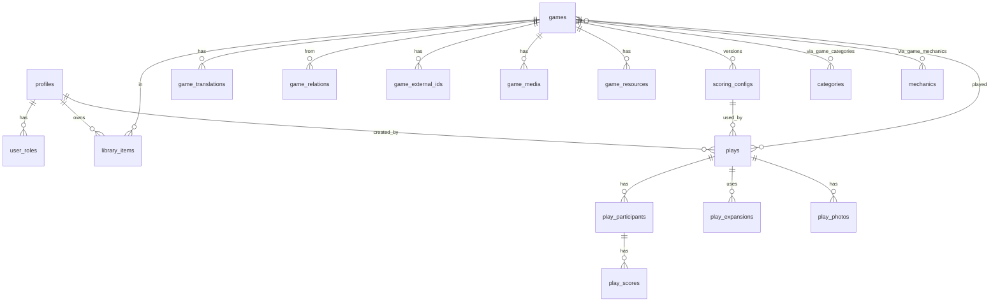

# Amika — Modelo de datos

> v2 · 2026-11-15 (revisado: Clerk como identidad, catálogo bajo demanda, partidas simples). PostgreSQL (Supabase), esquema `public`.

## 1. Convenciones
- **Identidad externa (Clerk)**: los usuarios no viven en `auth.users`. El ID de usuario es el `sub` del JWT de Clerk (`user_2abc…`), por tanto **`text`**, no `uuid`. Helper `public.current_user_id() returns text` = `(select auth.jwt()->>'sub')`. Sin FK a `auth.users`.
- Resto de PK `uuid` (`gen_random_uuid()`); `created_at`/`updated_at` con trigger.
- FKs con índice y `on delete` explícito.
- Locales como `text` con CHECK (`^[a-z]{2}(-[A-Z]{2})?$`), no enum, para añadir idiomas sin migrar tipos.
- Borrado real (RGPD), no soft-delete.
- RLS en **todas** las tablas desde 0001 (ver [SECURITY](SECURITY.md)).
- Estadísticas bajo demanda: vistas/funciones con `security_invoker`.

## 2. Diagrama

## 3. Identidad
| Tabla | Campos |
|---|---|
| `profiles` | `id text` PK (= Clerk user id, `default current_user_id()`), `display_name`, `avatar_path`, `locale` (default `en`), `theme` (`light\|dark\|system`), `is_public` (default false), timestamps. |
| `user_roles` | `user_id text`, `role` (`admin\|moderator`). Solo escribible con service_role. |

**Creación del perfil**: ya no hay trigger sobre `auth.users`. Se crea (a) de forma perezosa en el primer acceso (`ensureProfile`, idempotente) y (b) por webhook de Clerk `user.created`. El webhook `user.deleted` dispara el borrado de datos (ver SECURITY §8). Webhooks verificados con firma (Svix).

`public.is_admin()` `SECURITY DEFINER`, `search_path` fijo, consulta `user_roles` por `current_user_id()`.

## 4. Catálogo global (caché bajo demanda)
El catálogo **no se precarga**: se llena cuando un usuario busca/añade un juego que aún no existe. Un servicio de servidor consulta la fuente externa (BGG), guarda lo mínimo en `games` con `service_role` (los usuarios nunca escriben en el catálogo global) y registra `fetched_at`.

| Tabla | Notas |
|---|---|
| `games` | `kind` (`base\|expansion`), `slug`, `original_name`, `year_published`, `min/max_players`, `min/max_playtime`, `min_age`, `original_language`, `cover_url`, **`source`** (`bgg\|manual`), **`fetched_at`**, **`owner_id text null`** (null = global; no null = juego propio privado de ese usuario). CHECK min ≤ max. |
| `game_translations` | (`game_id`,`locale`): `name`, `description`. |
| `game_relations` | `game_id`, `related_game_id`, `type` (`expansion_of\|reimplements\|includes`). |
| `categories`, `mechanics` (+ `*_translations`) y puentes | Etiquetas globales. |
| `publishers`, `designers` y puentes | Opcionales; se rellenan si la fuente los da. |
| `game_external_ids` | (`source`,`external_id`) único; ej. `bgg:13`. Clave para no duplicar al importar. |
| `game_media` | Galería con `license` y `attribution`. |

**Juego propio**: si no aparece en la fuente, el usuario crea uno con `owner_id = su id`; solo él lo ve. Un admin puede promocionarlo a global.

**Pendiente (BGG)**: qué campos e imágenes se pueden guardar/mostrar. Mientras no se verifique, guardar solo metadatos básicos + ID, y mostrar la portada enlazada con atribución.

## 5. Game Center
| Tabla | Notas |
|---|---|
| `game_resources` | `game_id`, `kind` (`rules\|video\|link\|manual`), `locale`, `url`, `title`, `is_official`, `source_locale`. Reglas: siempre `en` + los idiomas que existan, cada uno como fila. Vídeos = ID de YouTube. Manuales solo como enlace oficial. |
| `rules_content` | Resumen propio de reglas: `game_id`, `locale`, `body_md`, `source_locale`, `is_machine_translated`. |
| `faq_entries` / `faq_translations` | Preguntas por juego e idioma. |

## 6. Biblioteca (privada)
`library_items`: `user_id text`, `game_id`, `status` (`owned\|wishlist\|previously_owned`), `is_favorite`, `rating` (1–10), `notes`, `acquired_at`. Único (`user_id`,`game_id`). Añadir un juego a la biblioteca dispara la importación del juego si no está en la caché.

## 7. Partidas (MVP: solo del creador)
| Tabla | Notas |
|---|---|
| `plays` | `created_by text`, `game_id`, `played_at`, `duration_minutes`, `scoring_config_id` (nullable), `notes`, `extra jsonb`. |
| `play_participants` | `play_id`, `display_name` (texto libre), `user_id text null` (reservado para enlazar usuarios en Fase 8; en MVP solo el propio creador), `seat`, `is_winner`, `total_score`, `rank`. |
| `play_scores` | `participant_id`, `category_key`, `value jsonb`; único (`participant_id`,`category_key`). |
| `play_expansions` | `play_id`, `game_id`. |
| `play_photos` | `play_id`, `storage_path`. Bucket privado. |

Compartir partidas con otros usuarios (enlace pendiente→aceptado) queda para la Fase 8; el esquema lo admite añadiendo `link_status` sin romper datos.

## 8. Motor de puntuación
`scoring_configs`: `game_id`, `version`, `status` (`draft\|published`), `definition jsonb` (validado con Zod), `published_at`. Único (`game_id`,`version`). Trigger impide editar `definition` al estar publicada. Las partidas guardan la versión usada.

## 9. Estadísticas
Vistas/funciones SQL con `security_invoker = true`. Índices: `plays(game_id, played_at)`, `play_participants(user_id, play_id)`. Sin materializar en MVP.

## 10. Storage
| Bucket | Acceso |
|---|---|
| `avatars` | Lectura pública; escritura solo en `<clerk_user_id>/…` |
| `play-photos` | Privado; `<clerk_user_id>/<play_id>/…`; URLs firmadas |

Las políticas de Storage usan `(select auth.jwt()->>'sub')` y `storage.foldername(name)`.

## 11. Migraciones propuestas
`0001` helpers (`current_user_id`, `set_updated_at`, `is_admin`), `profiles`, `user_roles`, RLS · `0002` catálogo + caché · `0003` biblioteca · `0004` Game Center · `0005` partidas + scoring · `0006` vistas de estadísticas · `0007` storage.
