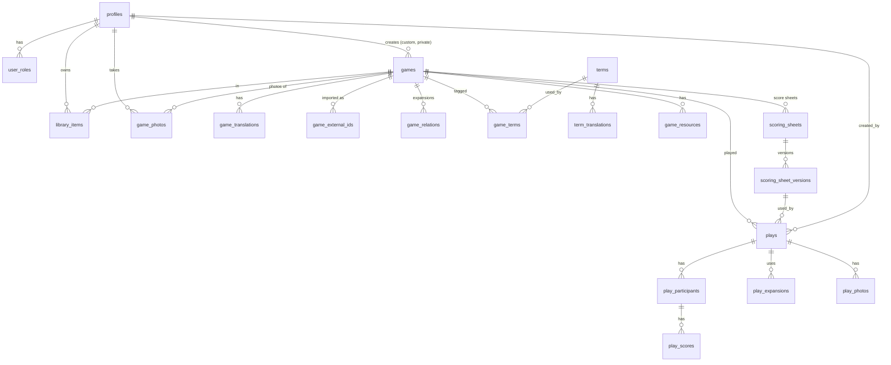

# Amika — Modelo de datos

> v2 · 2026-11-15 (revisado: Clerk como identidad, catálogo bajo demanda, partidas simples). PostgreSQL (Supabase), esquema `public`.

## 1. Convenciones
- **Identidad externa (Clerk)**: los usuarios no viven en `auth.users`. El ID de usuario es el `sub` del JWT de Clerk (`user_2abc…`), por tanto **`text`**, no `uuid`. Helper `public.current_user_id() returns text` = `(select auth.jwt()->>'sub')`. Sin FK a `auth.users`.
- Resto de PK `uuid` (`gen_random_uuid()`); `created_at`/`updated_at` con trigger.
- FKs con índice y `on delete` explícito.
- Locales como `text` con CHECK (`^[a-z]{2}(-[A-Z]{2})?$`), no enum, para añadir idiomas sin migrar tipos.
- Borrado real (RGPD), no soft-delete.
- RLS en **todas** las tablas desde 0001 (ver [SECURITY](SECURITY.md)).
- Estadísticas bajo demanda: vistas/funciones con `security_invoker`.

## 2. Diagrama

## 3. Identidad
| Tabla | Campos |
|---|---|
| `profiles` | `id text` PK (= Clerk user id, `default current_user_id()`), `display_name`, `avatar_path`, `locale` (default `en`), `theme` (`light\|dark\|system`), `is_public` (default false), timestamps. |
| `user_roles` | `user_id text`, `role` (`admin\|moderator`). Solo escribible con service_role. |

**Creación del perfil**: ya no hay trigger sobre `auth.users`. Se crea (a) de forma perezosa en el primer acceso (`ensureProfile`, idempotente) y (b) por webhook de Clerk `user.created`. El webhook `user.deleted` dispara el borrado de datos (ver SECURITY §8). Webhooks verificados con firma (Svix).

`public.is_admin()` `SECURITY DEFINER`, `search_path` fijo, consulta `user_roles` por `current_user_id()`.

## 4. Catálogo global (caché bajo demanda) — implementado en 0002/0004
El catálogo **no se precarga**: un servicio de servidor consulta la fuente externa (BGG) cuando alguien añade un juego que aún no existe y lo guarda con `service_role` mediante la función atómica `upsert_external_game(jsonb)`. Los usuarios nunca escriben en el catálogo global.

| Tabla | Notas |
|---|---|
| `games` | `kind` (`base\|expansion`), `name`, `original_name`, `year_published`, `min/max_players`, `min/max_playtime`, `min_age`, `original_language`, `cover_url` (solo `https://`, **enlazada, no copiada**), `source` (`bgg\|manual`), `owner_id` (null = global; si no, juego propio privado), `fetched_at`. CHECKs: mín ≤ máx y `(source='manual') = (owner_id is not null)`. Índice GIN trigram sobre `f_unaccent(name)`. |
| `game_translations` | (`game_id`,`locale`): `name`, `description`. BGG aporta solo `en`; los juegos propios, el idioma del usuario. |
| `game_external_ids` | (`game_id`,`source`) y único (`source`,`external_id`): evita duplicados al importar. |
| `game_relations` | Expansiones: `type` (`has_expansion\|expansion_of\|…`), `related_game_id` (nulo si aún no importado) + referencia externa (`related_external_id`, `related_name`). Se resuelve al leer. |
| `terms`, `term_translations`, `game_terms` | **Una sola estructura** para categorías, mecánicas, diseñadores y editoriales (`type`). Sustituye a las 8+ tablas previstas inicialmente (ver ADR-020). |
| `catalog_imports` | Registro por usuario (`user_id`, `source`, `external_id`, `created_at`) para el límite de uso; sin acceso para usuarios. |

**Búsqueda**: `search_games(q, p_kind, p_players, p_max_minutes, p_limit)`, `SECURITY INVOKER` (la RLS decide qué ve cada usuario), insensible a mayúsculas y acentos (`unaccent`), con comodines `%`/`_` escapados, ordenada por similitud.

**Importación**: `upsert_external_game(p jsonb)` crea o actualiza juego + id externo + traducción + términos + relaciones en **una transacción**, es idempotente y solo ejecutable por `service_role`.

**Juego propio**: si no aparece en la fuente, el usuario crea uno (`source='manual'`); solo él lo ve. No se puede promocionar a global desde la API (la RLS lo impide).

**Pendiente (BGG)**: qué campos e imágenes se pueden guardar/mostrar según sus términos; mientras tanto solo metadatos básicos + ID, portada enlazada con atribución.

## 5. Game Center — implementado en 0006
Solo para juegos **globales**: un juego propio y privado no tiene Game Center. El contenido lo escribe un **administrador**; los usuarios solo pueden **proponer preguntas frecuentes** (decisión del usuario, ADR-026).

| Tabla | Notas |
|---|---|
| `game_resources` | `kind` (`rules\|video\|link`), `locale` (null = cualquier idioma), `title`, `url` (solo `https://`) o `youtube_id` (11 caracteres), `is_official`, `sort`. CHECK de forma: un vídeo es **solo** un id de YouTube; el resto, **solo** una URL https. Los manuales con copyright **no se alojan**: solo enlaces. |
| `game_resources` (manuales) | Además: `publisher` (editorial, si se conoce) y `verified_at` (cuándo se comprobó que el enlace servía un PDF). Índice único `(game_id, url)` para `kind='rules'`: sin enlaces de reglas duplicados. |
| `manual_suggestions` | Propuestas del buscador de manuales: `game_id`, `url` (https ≤500), `title`, `locale`, `publisher`, `source_host`, `is_official`, `size_bytes`, `verified_at`, `status` (`pending\|rejected`), `created_by`. Único `(game_id, url)` (un rechazo bloquea volver a proponer el mismo enlace); máx. **5 pendientes** por usuario y juego (trigger). `publish_manual_suggestion(id)` la pasa a `game_resources` de forma atómica (solo administradores). |
| `manual_search_cache` | Búsquedas ya verificadas, una fila por juego (`game_id`, `outcome` `results\|not_found`, `results` jsonb con un array, `created_at`). Compartida por todos los usuarios y **sin datos por usuario** (ni enlaces firmados ni «ya añadido»); se borra con el juego. Sin acceso para usuarios, solo `service_role`. |
| `manual_requests` | Registro por usuario (`user_id`, `kind` `search\|download\|api_call`, `created_at`) para los límites del buscador; sin acceso para usuarios, solo `service_role`. |
| `rules_content` | Resumen de reglas con palabras propias, una fila por idioma (`game_id`,`locale`,`body` ≤20 000). Texto plano. |
| `game_images` | Galería de imágenes **enlazadas** con `attribution` obligatoria (+ licencia y pie opcionales). No se copian archivos. |
| `faq_entries` | `status` (`pending\|published\|rejected`), `created_by`, `reviewed_by/at`. Máximo **5 sugerencias pendientes** por usuario y juego (trigger). |
| `faq_translations` | (`faq_id`,`locale`): `question` ≤300, `answer` ≤3000. |

Visibilidad de FAQ: lo publicado lo ve todo el mundo; una sugerencia pendiente o rechazada solo su autor y los administradores. El autor puede editar o retirar la suya **mientras esté pendiente**; nunca puede publicarla él mismo.
Idiomas: se muestra el del usuario, luego el inglés y luego cualquiera, con una etiqueta cuando difiere.

## 6. Biblioteca (privada) — implementado en 0005
`library_items`: `user_id` (por defecto el `sub` del token), `game_id`, `status` (**`owned` | `previously_owned`**; la lista de deseos queda fuera por decisión del usuario del 2026-11-15, añadirla es ampliar el CHECK), `is_favorite`, `rating` (1–10, opcional), `notes` (≤2000), timestamps. Único (`user_id`,`game_id`). RLS: solo el dueño lee, edita y borra; solo puede añadir juegos que **puede ver** (no los privados de otro). Se borra en cascada con el juego y con la cuenta.

`search_library(q, p_status, p_favorites, p_limit)`: la biblioteca del usuario unida a `games`, insensible a acentos, con filtros de estado y favoritos; `SECURITY INVOKER`.

Pendiente a propósito: etiquetas personales y fecha de adquisición (sin necesidad real todavía).

## 7. Partidas — implementado en 0010 (Fase 5b)
Solo del creador; los demás jugadores son entradas de **su lista de jugadores** (ver abajo). Las **registra solo desde la ficha del juego** (sin elemento nuevo en la navegación).

| Tabla | Notas |
|---|---|
| `plays` | `created_by` (por defecto el `sub` del token), `game_id` (visible), `played_on date`, `duration_minutes` (1–1440), `scoring_version_id` (nullable → `scoring_sheet_versions`, FK `no action`; null = totales a mano), `notes` (≤2000). Máx. **5 000 por usuario** (trigger). |
| `play_participants` | `play_id`, `seat` (0–11, único por partida), **`player_id` → `players`** (obligatorio, FK `no action`; **único por partida**: un jugador no aparece dos veces), `total_score` (nulo = nada registrado), `rank`, `is_winner`. Máx. **12 por partida**. (6a: sustituye a `display_name`.) |
| `play_scores` | `participant_id`, `category_key` (patrón de clave), `value jsonb` (≤500 bytes); clave primaria (`participant_id`,`category_key`). |
| `play_expansions` | `play_id`, `game_id` (debe ser una expansión visible). Máx. **20 por partida**. |

**Escritura atómica**: `save_play(p jsonb)` (`security invoker`, solo `authenticated`) crea o reemplaza la partida y todos sus hijos en una transacción; con `playId` no cambia ni el juego ni la hoja y da `P0002` si la partida no es visible. **Totales, puestos y ganadores los calcula el servidor** (`features/plays/compute.ts` + el motor de la 5a) y el input los rechaza (esquemas estrictos); el navegador solo los calcula para mostrarlos en vivo.

**Reglas**: gana la puntuación más alta; empates: todos ganan; un jugador sin nada registrado no tiene total ni puesto; si nadie tiene puntuación, no hay ganador. La hoja queda fija al crear la partida (cambiar de hoja = partida nueva); editar recalcula con la versión guardada.

**FK `no action` hacia la versión** (no `restrict`): borrar la cuenta o el juego sigue limpiando en cascada (probado), y borrar una hoja con partidas se rechaza (`23503`; la aplicación lo muestra como «hoja en uso»).

### Lista de jugadores (6a: migración 0014, ADR-034)
- **`players`**: `owner_id` (el creador), `name` (1–60), `linked_user_id` (hoy solo el propio creador = **«soy yo»**, como máximo uno; enlazar cuentas ajenas es de la Fase 8). **Único por (`owner_id`, nombre normalizado)**: `normalize_player_name` = minúsculas, sin acentos, espacios colapsados, así «Ana», «ana » y «Aná» son el mismo jugador. Tope de **200 por usuario**. Permisos por columna (`name`, `linked_user_id`); RLS solo del dueño.
- **`save_play`** recibe por participante `playerId` (debe ser tuyo) o `name`: si no hay `playerId` crea el jugador o **reutiliza** el que tenga el mismo nombre normalizado, todo en la misma transacción.
- **`player_groups`** (Fase 8b): `owner_id`, `name` (1–60, **único por dueño** tras normalizar como los jugadores), máx. **50 por usuario**. **`player_group_members`** (`group_id`, `player_id`; clave primaria compuesta, borrado en cascada por ambos lados; el jugador debe ser del mismo dueño: lo comprueba la política de inserción). Un grupo es solo un atajo: la partida no lo guarda.
- **`merge_players(keep, remove)`** (`security invoker`): mueve las partidas (y su pertenencia a grupos, sin duplicar) del segundo al primero y lo borra (traspasa «soy yo»); se rechaza con `PL001` si jugaron juntos en alguna partida (quedaría uno dos veces) y con `P0002` si no son tuyos. **Renombrar** a un nombre que ya existe falla (`23505`: hay que fusionar). **Borrar** un jugador con partidas falla (`23503`; la aplicación dice «tiene partidas»).
- **Migración de datos**: un jugador por (creador, nombre normalizado) a partir de los `display_name` existentes (la grafía de la primera aparición); si una partida tenía dos nombres que normalizan igual, el segundo pasa a «Nombre (2)»; si el reparto dejara un hueco o un jugador repetido, la migración **aborta** sin aplicar nada. Se ensayó con datos realistas en una transacción revertida antes de aplicarla.
- Al borrar la cuenta, `cleanup_user_content` borra antes las partidas del usuario, así que `players` cae en cascada sin chocar con la FK.

Fotos de partida: Fase 7. Compartir partidas con otros usuarios: Fase 8.

## 8. Hojas de puntuación — implementado en 0007–0009 (5a) y 0011–0012 (5c)
Cualquier usuario puede crear hojas (ADR-030). Empiezan **privadas**; se pueden **publicar** (ver «Compartir» abajo).

| Tabla | Notas |
|---|---|
| `scoring_sheets` | `game_id`, `owner_id` (autor, por defecto el `sub` del token), `title` (≤80), `locale`, `visibility` (`private\|public`; la RLS solo admite `private` por ahora), `copied_from` (→ hoja origen, `set null`). Máx. **20 hojas privadas por usuario y juego** (trigger). `game_id` y `owner_id` no se pueden cambiar. |
| `scoring_sheet_versions` | `sheet_id`, `version` (≥1), `definition jsonb` (objeto, ≤50 000 bytes). Único (`sheet_id`,`version`). **Inmutables**: no hay política de `update` ni de `delete` (0009: nadie borra o reescribe una versión suelta; solo se van con su hoja, por cascada) y un trigger impide el `update` hasta con roles privilegiados. Máx. **50 versiones por hoja**. |

**Numeración y conflictos (0008)**: el cliente indica la versión que va a crear (la que cargó + 1); el trigger solo la acepta si es de verdad la siguiente. Si otra pestaña guardó antes, falla con `23505` y la aplicación lo muestra como «conflicto» en lugar de pisar la última versión. Con `version` nulo se numera sola (max + 1).

**La definición no es de fiar**: un usuario con su JWT puede escribir filas por la API sin pasar por nuestro Zod. Por eso la base impone tipo y tamaño y la aplicación vuelve a validar (`validateDefinition`) cada vez que lee una; el motor (`evaluate`) también revalida y nunca lanza.

**Definición** (`schemaVersion: 1`, validada con Zod): lista de 1–40 categorías con `key` estable y única (`^[a-z][a-z0-9_]{0,29}$`, se genera una vez y no se edita), `label` (≤60), `scoring` (suma al total) y un `type` de un catálogo cerrado: `number`, `count_times`, `per_n`, `boolean`, `choice`, `table` (valor exacto → puntos), `set_bonus` (suma de cuadrados + puntos por serie completa) y `derived` (`sum|product|floor_div|min|max` sobre los **puntos** de otras categorías; sin ciclos). Solo enteros, dentro de ±1 000 000. Ver ADR-031.

### Compartir hojas (5c: migraciones 0011 y 0012, ADR-033)
- **Columnas nuevas de `scoring_sheets`**: `published_at`, `verified_at/by`, `disabled_at/by`; `owner_id` pasa a **poder ser nulo** (autor anónimo, FK `on delete set null`). Permisos por columna: el usuario solo escribe `id, game_id, owner_id, title, locale, visibility, copied_from` al insertar y `title, locale, visibility` al actualizar; `published_at`, `verified_*` y `disabled_*` solo las tocan triggers y funciones de administrador.
- **Publicar**: solo hojas de juegos del **catálogo** (`PB001` si no) y máx. **5 publicaciones por usuario y día** (`PB002`); despublicar quita el sello «verificada». Tope de 20 hojas por usuario y juego (cualquier visibilidad). El tope diario cuenta `published_at` de las **otras** hojas: borrar una publicada libera el cupo (fricción anti-spam, no una cuota estricta).
- **Quién ve qué**: el autor; cualquiera si es `public` y no está desactivada; el administrador (también las desactivadas); y **quien tenga una partida con una versión de esa hoja** (función `i_use_sheet`, `security definer` para evitar recursión de políticas) aunque se despublique o desactive después. Una partida **nueva** solo puede usar hojas propias o públicas no desactivadas (`version_is_usable`).
- **`scoring_votes`**: (`version_id`, `user_id`, `play_id` nulo si se borra la partida, `kind` `up|flag`, `reason` obligatorio de 1–300 si es `flag` y prohibido si es `up`; 0012 corrigió un CHECK que dejaba pasar un aviso sin motivo). Único por (`user_id`,`version_id`), cambiable y borrable por su autor; la política de `update` repite la comprobación de «no la hoja propia» (0013: se podía mover un voto existente a la hoja propia). Solo se vota con **una partida propia que use exactamente esa versión** y nunca la hoja propia. Cada usuario ve solo sus votos; el administrador ve todos.
- **`sheet_rankings(p_game_id)`** (`security definer`): hojas del juego visibles para quien llama, con votos y usos de la **última versión**, puntuación = límite inferior de Wilson (z = 1,96; 0 sin votos) y orden verificada → puntuación → usos → antigüedad. No devuelve nunca al autor.
- **Administrador** (sin política general de actualización): `admin_set_sheet_verified`, `admin_set_sheet_disabled` y `admin_sheet_flags` comprueban `is_admin()` dentro. Verificar exige hoja pública y activa; desactivar y despublicar quitan el sello, y **guardar una versión nueva también** (0013: lo verificado es lo que el administrador revisó). Una hoja desactivada se puede seguir leyendo (quien la usó) pero **no copiar**.
- **Borrar una cuenta** (`before delete` sobre `profiles`): se borran sus partidas y sus hojas que nadie más usó; las que tienen partidas de otros se quedan **anónimas** (`owner_id` nulo) con sus versiones. Pendiente revisar frente a RGPD antes de la Fase 9.
- **Topes sin carrera**: los triggers de topes (hojas, versiones, partidas, jugadores, expansiones) bloquean la fila padre con `for update`. `plays` solo admite actualizar `played_on`, `duration_minutes` y `notes` (permisos por columna).

## 9. Estadísticas — implementado en 0015 (Fase 6b)
Funciones SQL de **solo lectura**, `security invoker`, `stable`, `set search_path = ''`, ejecutables solo por `authenticated`. La RLS de las partidas decide qué se cuenta, así que solo se agregan las partidas propias. Se agrupa siempre por `player_id` (el nombre se lee al mostrar): renombrar y fusionar jugadores se refleja solo. Sin materializar en MVP.

- Un participante sin total no es «partida puntuada»: no gana y no entra en medias. Empates: ganan todos los empatados. El **porcentaje de victorias** lo calcula la aplicación (victorias ÷ partidas puntuadas), no el SQL.
- `game_stats(game)`: por jugador, partidas, partidas puntuadas, victorias, media y mejor puntuación (orden: victorias, puntuadas, nombre). `game_summary(game)`: siempre una fila (partidas, duración media de las que la tienen, primera y última fecha).
- `game_score_series(game, limit = 100)`: puntuaciones de las **últimas `limit` partidas** (1–200; acotado a propósito porque un usuario puede tener 5 000), en orden cronológico; `seq` numera esas partidas de 1 a N (una partida sin puntuaciones conserva su número y no da filas).
- `my_overview()`, `my_top_games(limit = 5)` y `head_to_head()` parten del jugador **«soy yo»** (`players.linked_user_id` = el usuario). Sin «soy yo»: ceros y `me_player_id` nulo, sin juegos y sin rivales. `head_to_head` cuenta solo partidas en las que **ambos tienen puesto** (una partida sin puntuaciones no dice quién ganó); los rivales sin partidas así no aparecen; los empates se cuentan aparte.

## 9b. Reconocimiento local de juegos — 0016 (Fase 7a) y 0017 (Fase 7a-2)
Para identificar un juego **en el dispositivo** (ninguna imagen se envía) solo se guardan **códigos de barras**, nunca imágenes. La migración 0017 (Fase 7a-2) **eliminó** `game_image_hashes`, `match_game_images`, `save_photo_hash`, `upsert_cover_hash`, `hex_to_hash` y `enforce_image_hash_cap`: el parecido de imágenes ahora se calcula en el navegador (vectores en IndexedDB, que son del dispositivo y no de la base de datos). Un test de integración comprueba que esos objetos ya no existen.
- **`game_barcodes`** (`user_id`, `gtin` de 13 dígitos, `game_id`): códigos que el usuario ha enseñado a la aplicación. **Privados por usuario** (RLS solo del dueño); el juego debe ser visible; único por (`user_id`, `gtin`); solo se puede reapuntar `game_id`; tope de **500 por usuario** (el disparador bloquea la fila del perfil).
- `anon` no ejecuta ninguna función ni lee ninguna tabla.

## 10. Storage y fotos propias — implementado en 0003
| Bucket | Acceso |
|---|---|
| `game-photos` | **Privado**; 5 MiB; solo `image/jpeg\|png\|webp`. Ruta `<clerk_user_id>/<game_id>/<uuid>.jpg`. Políticas `storage.objects`: leer/escribir/borrar solo si la primera carpeta es tu id. |
| `avatars` | No se crea: el avatar lo gestiona Clerk. |

`game_photos` (`user_id`, `game_id`, `storage_path`): RLS solo propietario; `CHECK storage_path like user_id || '/%'`; solo sobre juegos que el usuario puede ver; **máximo 10 por usuario y juego** (trigger). El navegador reduce la imagen a ≤1600 px y la recodifica a JPEG, lo que **elimina los metadatos EXIF** (ubicación GPS, etc.). Se muestran con URLs firmadas de 1 h.

Al borrar la cuenta, `deleteUserData` elimina primero los archivos (las filas se borran en cascada, los archivos no) y después el perfil.

## 11. Migraciones aplicadas
`20261115180000_foundations` (perfiles, roles, RLS) · `20261115200000_catalog` (catálogo, búsqueda, RLS) · `20261115210000_game_photos` (fotos + bucket) · `20261115220000_import_function` (importación atómica + tope de fotos) · `20261115230000_library` (biblioteca + `search_library`) · `20261116000000_game_center` (recursos, reglas, imágenes, FAQ) · `20261116100000_scoring_sheets` (hojas y versiones) · `20261116110000_scoring_version_guard` (control de concurrencia de versiones) · `20261116120000_scoring_versions_no_delete` (las versiones no se borran sueltas) · `20261116130000_plays` (partidas, participantes, puntuaciones, expansiones y `save_play`) · `20261116140000_sheet_sharing` (publicar, votar, clasificar y moderar hojas; borrado de cuenta; permisos por columna; topes sin carrera) · `20261116150000_votes_check_fix` (un aviso exige motivo) · `20261116160000_vote_integrity` (no votar la hoja propia vía UPDATE; una versión nueva quita «verificada») · `20261116170000_players` (lista de jugadores, `player_id` en los participantes, `save_play` y `merge_players`) · `20261116180000_stats` (funciones de estadísticas, solo lectura) · `20261116190000_recognition` (códigos de barras y hashes de imagen para el reconocimiento local).
Pendientes: vistas de estadísticas (6).

## Fase 8a: partidas compartidas (migraciones 0020–0026)
- `plays`: `owner_id` (dueño actual), `status` (`open`/`closed`); `created_by` pasa a ser histórico y anulable (`on delete set null`).
- `play_participants`: `user_id` (cuenta tras el asiento) y `display_name` (instantánea del nombre). `unique (play_id, seat)` diferible.
- `play_members(play_id, user_id, status, invited_by, participant_id)`: quién tiene acceso (`invited | accepted | declined | left`). Nadie escribe directamente: lo hacen las funciones.
- `friend_invites`, `friendships`, `player_link_requests`: sin políticas ni permisos; solo funciones.
- Funciones nuevas: `is_play_member`, `is_play_owner`, `can_write_scores`, `play_sheet`, `create_friend_invite`, `redeem_friend_invite`, `revoke_friend_invite`, `list_friends`, `remove_friend`, `invite_to_play`, `respond_play_invite`, `leave_play`, `list_my_invites`, `link_player_to_friend`, `list_my_link_requests`, `respond_player_link`, `unlink_player`, `close_play`, `save_my_scores`, `delete_play`, `transfer_or_delete_plays`, `my_participants`.
- Reescritas: `save_play` (actualiza en su sitio), `merge_players`, `game_stats`, `game_score_series`, `my_overview` (añade `shared_plays`), `my_top_games`, `head_to_head`, `cleanup_user_content`.
- Realtime: `plays`, `play_participants`, `play_scores`, `play_members` en la publicación `supabase_realtime`, con `replica identity full`.

`20261118100000_player_groups` (grupos de jugadores y sus miembros; `merge_players` traslada la pertenencia a grupos).

## Fase 8d: noche de juegos (migraciones 20261121100000 a 20261121130000, ADR-049)
- `game_nights(id, owner_id, title, starts_on, players, max_minutes, group_id, status, ...)`: la noche del anfitrión (`open | closed`). RLS: la ve el dueño y sus miembros aceptados.
- `game_night_games(night_id, game_id, added_by, source, pinned, played, name_snapshot, cover_snapshot)`: juegos de la lista (`host | suggested`); nombre y portada copiados para que el invitado no lea la ficha. `unique (night_id, game_id)`.
- `game_night_members(night_id, user_id, status)`: amigos invitados (`invited | accepted | declined`); nadie escribe directamente, lo hacen las funciones. Salir de la noche conserva los votos.
- `game_night_votes(night_game_id, user_id | guest_id)`: un voto por persona y juego (`num_nonnulls(user_id, guest_id) = 1`, índices únicos parciales). Los votos de invitado caen con el invitado.
- `game_night_links(night_id, token_hash, expires_at, revoked_at)`: enlace público; solo el sha256 del token, un enlace activo por noche.
- `game_night_guests(link_id, key_hash, display_name)`: invitado sin cuenta; solo el hash de su clave. `unique (link_id, key_hash)`.
- `game_night_requests(link_id, guest_id, created_at)`: registro de frecuencia del route handler (límite blando).
- Las tres últimas tablas no tienen políticas ni permisos para `anon`/`authenticated`: solo `service_role` mediante las funciones `guest_*`. Función `picker_candidates` (`security invoker`, solo lectura) para el selector.
